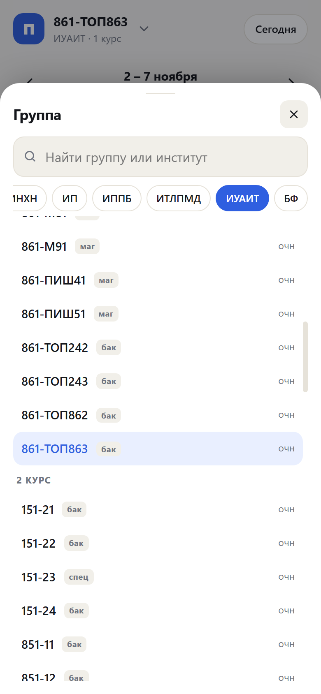
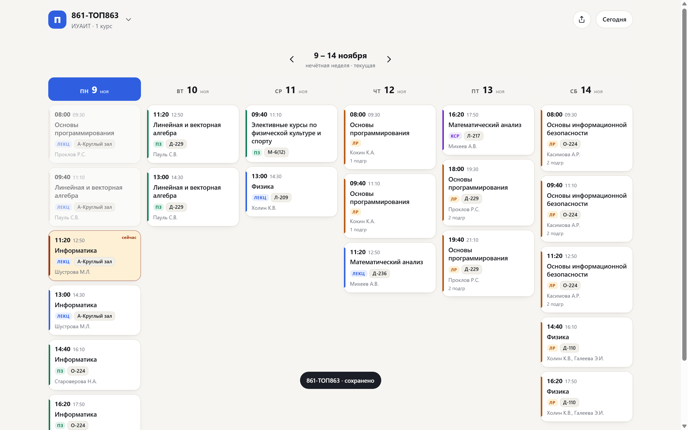
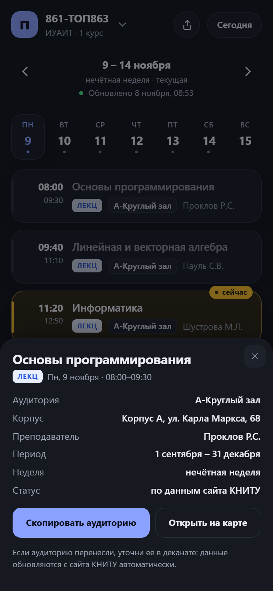

# Пары — расписание КНИТУ

Лёгкое веб-приложение с расписанием занятий КНИТУ (бывш. КХТИ): выбор группы,
дни недели, пары, преподаватели и аудитории. Без фреймворков, картинок и
внешних шрифтов — открывается быстро даже на слабом интернете и работает
офлайн после первого визита.

**Живой сайт:** <https://samkrusa.github.io/pary/>

| Телефон | Выбор группы |
|---|---|
|  |  |

На компьютере — вся неделя одной сеткой, без «узкой колонки»:



## Что умеет

- Выбор группы с поиском и запоминанием на устройстве.
- Вся неделя сеткой на ПК, дни-табы на телефоне; чётность недели считается сама.
- Нажатие на пару открывает карточку: аудитория, корпус, преподаватель,
  подгруппа, период действия. Можно скопировать аудиторию и открыть корпус
  на Яндекс.Картах с меткой.
- Отметка актуальности: «Обновлено …» под неделей; если данных нет дольше
  двух суток — предупреждение.
- Отмены и переносы отмечаются бейджем, если вуз их указывает в расписании.
- Прошедшие пары приглушены, но время и аудитория остаются контрастными.



## Что внутри

- `index.html`, `style.css`, `app.js` — само приложение (≈ 40 КБ, ≈ 12 КБ в gzip).
- `sw.js`, `manifest.webmanifest`, `icon.svg`, `icon-180.png`, `icon-192.png`,
  `icon-512.png` — офлайн-режим, установка на телефон и иконки (включая
  `apple-touch-icon` для iOS).
- `data/index.json` — список институтов.
- `data/i/<институт>.json` — группы института (грузятся только при выборе).
- `data/g/<группа>.json` — расписание одной группы (≈ 5–8 КБ).
- `tools/scrape.py` — сборщик данных с сайта вуза.

Данные собраны 7 ноября 2026 года: 590 групп, 9 институтов.

## Запуск

На Windows — двойной клик по `run.cmd`: поднимется локальный сервер и
откроется браузер.

Вручную из папки проекта:

```bash
python -m http.server 8123
```

Открыть <http://127.0.0.1:8123>. Просто открыть `index.html` двойным кликом
не получится: браузер не даст загрузить JSON с диска.

## Установка на телефон

Это сайт (PWA), а не приложение из App Store — скачивать ничего не нужно.

**iPhone / iPad (Safari):**
1. Открыть адрес сайта.
2. Нажать «Поделиться» (квадрат со стрелкой).
3. Выбрать «На экран «Домой»» → «Добавить».

**Android (Chrome):** меню → «Установить приложение» (или кнопка на баннере).


После установки приложение открывается с иконки без адресной строки и
работает офлайн.

## Обновление расписания

```bash
python tools/scrape.py            # использует кэш страниц
python tools/scrape.py --refresh  # скачать заново
python tools/scrape.py --only 320 # только один институт
```

Скрипт берёт две версии страницы — для чётной и нечётной недели, — склеивает
их и раскладывает по группам. Сырые страницы кэшируются в `tools/.cache/`
(папка создаётся сама и не попадает в git).

После обновления данных поднимите `VERSION` в `sw.js` (например, `pary-v2`) —
иначе у тех, кто уже открывал приложение, останется старая оболочка из кэша.

## Автообновление

Расписание обновляется само, без участия человека:

- GitHub Actions **каждый день в 05:00 МСК** запускает
  `python tools/scrape.py --refresh`, коммитит изменения и пушит их.
- GitHub Pages через минуту пересобирает сайт.
- Запустить вручную: Actions → `update-schedule` → **Run workflow**.
- Workflow: `.github/workflows/update-schedule.yml`.

Если GitHub Actions не сможет достучаться до `kstu.ru` (вуз иногда режет
зарубежные IP), есть резервный локальный вариант:

```powershell
powershell -ExecutionPolicy Bypass -File tools\auto-update.ps1
```

Его можно поставить в Планировщик задач Windows на удобное время — тогда
обновление будет идти с домашнего IP. Скрипт сам скачает расписание,
закоммитит и запушит изменения.

## Сохранение группы

Выбранная группа хранится в `localStorage` **и** в cookie на год, поэтому
переживает перезапуск браузера и очистку `localStorage`. Кнопка «Поделиться»
в шапке копирует ссылку вида `https://samkrusa.github.io/pary/#g=<файл>` —
по ней группа откроется даже на другом устройстве или после очистки данных.

## Публикация

Это статика: папку можно целиком положить на GitHub Pages или любой
статический хостинг. Никакого сервера приложению не нужно.

Для GitHub Pages:

```bash
git init && git add . && git commit -m "Пары: расписание КНИТУ"
git branch -M main
git remote add origin https://github.com/<user>/<repo>.git
git push -u origin main
```

Затем в настройках репозитория включить Pages → Deploy from branch → `main` / root.

## Как читать расписание

- Недели чередуются: чётная / нечётная. Приложение само считает чётность от
  опорной даты (`meta.anchor` в `data/index.json`).
- У каждого занятия есть период действия (`f`–`u`): если сегодня вне периода,
  пара не показывается.
- Поле `w`: `1` — только нечётная неделя, `2` — только чётная, `0` — каждую.
- Поле `st`: `Отменено` или `Перенесено`, если вуз указал это в расписании.

## Безопасность

Сайт полностью статический: нет сервера, базы данных, авторизации, форм и
загрузки файлов — поэтому SQL-инъекции, SSRF, CSRF и подделка сессий здесь
неприменимы по архитектуре.

Что сделано:

- **CSP** через `<meta>`: только свои скрипты и стили, запрет `object`/`base`,
  `form-action 'none'`.
- **Referrer-Policy** `strict-origin-when-cross-origin`.
- Весь текст из JSON экранируется перед вставкой в DOM (проверено XSS-пейлоадами).
- Имя файла группы валидируется по `^[a-z0-9-]+$` перед загрузкой.
- HSTS и TLS 1.2/1.3 обеспечивает GitHub Pages; HTTP/1.1 и старые TLS отключены.
- `robots.txt` и `sitemap.xml` для индексации.

Ограничение GitHub Pages: нельзя задать свои заголовки (`X-Frame-Options`,
`X-Content-Type-Options`, `Permissions-Policy`). CSP и Referrer-Policy заданы
через `<meta>`, остальное — ограничение хостинга.

## Правовая информация

Сайт — **неофициальный студенческий проект**, не связанный с КНИТУ. Название
вуза используется только для указания источника и предметной области.

- [legal.html](legal.html) — дисклеймер, права на данные, порядок обращения
  правообладателей (удаление по первому требованию).
- [privacy.html](privacy.html) — политика обработки персональных данных:
  сайт не собирает данные студентов, выбранная группа хранится только
  в браузере.
- Данные расписания взяты из открытого источника `kstu.ru`; исключительные
  права принадлежат правообладателю. Проект не претендует на них и готов
  убрать данные по запросу.
- Хостинг зарубежный (GitHub Pages), поэтому
  технические логи запросов могут обрабатываться за пределами РФ. Если нужен
  строгий режим 152-ФЗ с локальным хранением — сайт можно перенести на
  российский хостинг без изменения кода.

## Сколько живёт без обслуживания

- **GitHub Pages и HTTPS-сертификаты не истекают** — это
  бесплатные тарифы с автоматическим продлением. Платить и продлевать нечего.
- **Автообновление** работает ежедневно. GitHub отключает scheduled workflows
  после 60 дней без активности в репозитории, но каждый прогон меняет
  `meta.generated` и создаёт коммит — активности хватает.
- **При сбое** workflow создаёт issue «Автообновление: ошибка», а сайт
  продолжает работать на последних данных. Защита от затирания: если групп
  стало меньше 70 % от прошлой сборки, данные не перезаписываются.
- **Скрапер** может сломаться, если вуз поменяет вёрстку `www_F22grid.jsp`.
  Тогда обновление остановится, но сайт продолжит открываться со старым
  расписанием — до первой починки.
- **Раз в год** стоит потратить 15 минут: обновить версии actions
  (`checkout@v4`, `setup-python@v5` и т.п.) и убедиться, что данные свежие.
- **Свой домен** (если появится) продлевается раз в год.

## Мониторинг

- `.github/workflows/uptime.yml` — каждые 15 минут проверяет
  `samkrusa.github.io/pary`. Если адрес не отдаёт 200, создаётся issue
  «Сайт недоступен» с назначением на владельца (GitHub пришлёт письмо).
  Когда сайт оживает — issue закрывается автоматически.
- Проверка идёт из сети GitHub (США), поэтому видит глобальную доступность.
- Внешний вариант — UptimeRobot (бесплатно, 50 мониторов, интервал 5 минут):
  добавить URL, включить email-алерты.

## Ограничения

- Сайт вуза отдаёт сетку на текущий семестр; пары, которые начнутся позже,
  появятся после обновления данных.
- Если вуз поменяет вёрстку `www_F22grid.jsp`, нужно поправить `parse_table`
  и `parse_cell` в `tools/scrape.py`.
- Данные принадлежат КНИТУ; приложение лишь удобно их показывает.
